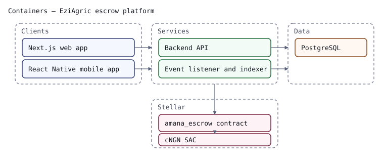
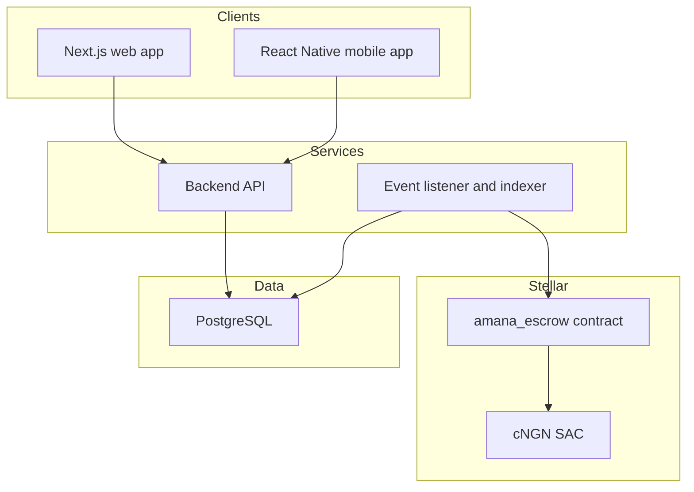

# Containers

How the system is built out of deployable pieces, and which pieces hold state.
Trust-bearing containers are marked in the notes below the diagram.

<!-- docref: docs/eziagric_contract_overview.md -->
<!-- docref: contracts/amana_escrow/src/lib.rs#DataKey -->

## Reading it

- **`amana_escrow contract`** is the only trust-bearing container: it holds
  escrowed cNGN and enforces every settlement rule. Its storage keys are listed
  in [the contract overview](../eziagric_contract_overview.md).
- **`cNGN SAC`** is the Stellar Asset Contract for cNGN. The escrow contract has
  no other way to move value.
- **`Backend API`** signs nothing by itself: every write it performs carries the
  signature of the party who asked for it. It caches read models in PostgreSQL.
- **`Event listener and indexer`** is the only container that follows contract
  events continuously. Its cursor and derived tables live in PostgreSQL, so the
  chain, not the database, is always the authority.
- **`Clients`** hold no keys at rest beyond the user's own signing key.

Because the indexer is where off-chain state meets on-chain truth, changes to
its event handling are arch-affecting: update this diagram when a new container
or data flow appears.
