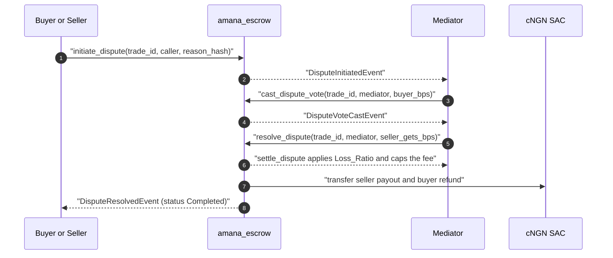

# Dispute sequence

What happens when a trade cannot be settled by agreement. The escrow stays in the
contract for the whole flow; only the final `resolve_dispute` moves money.

<!-- docref: contracts/amana_escrow/src/lib.rs#initiate_dispute -->
<!-- docref: contracts/amana_escrow/src/lib.rs#cast_dispute_vote -->
<!-- docref: contracts/amana_escrow/src/lib.rs#resolve_dispute -->
<!-- docref: contracts/amana_escrow/src/lib.rs#settle_dispute -->

## Reading it

- **`initiate_dispute`** flips the trade to `Disputed` and freezes normal
  settlement. Evidence submitted before this point is what the mediator reads.
- **Weighted quorum** is optional: a mediator can `cast_dispute_vote` and the
  quorum path (`DisputeQuorumResolvedEvent`) resolves the trade when enough
  weight has voted, including the fallback resolution once the vote window
  closes.
- **`resolve_dispute`** takes `seller_gets_bps` and hands it to the shared
  `settle_dispute` path, which applies the trade's loss ratio, charges the fee
  on the released amount only, and refuses to release more than the escrow.
- Both payouts leave through the cNGN SAC, so the on-chain trail of a disputed
  trade is complete without the backend.

A change to who may initiate, vote or resolve — or to the order of these calls —
is arch-affecting: update this diagram with the code change.
