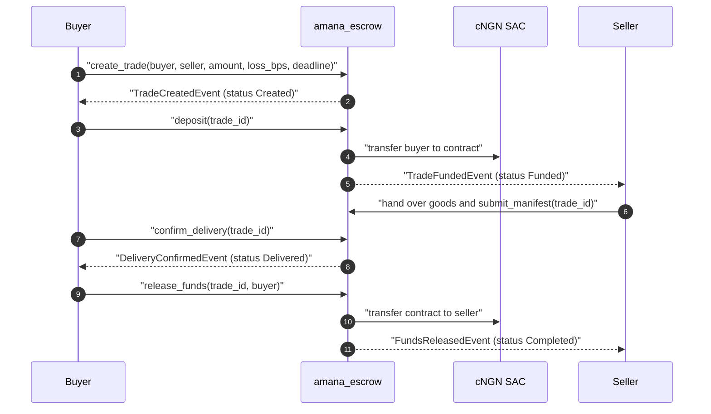
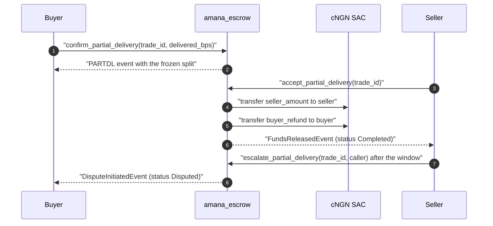

# Trade lifecycle sequences

The happy path from a signed agreement to money in the seller's hands, plus the
partial-delivery path that exists because shipments regularly arrive short.

## Create, fund, deliver, release

<!-- docref: contracts/amana_escrow/src/lib.rs#create_trade -->
<!-- docref: contracts/amana_escrow/src/lib.rs#deposit -->
<!-- docref: contracts/amana_escrow/src/lib.rs#confirm_delivery -->
<!-- docref: contracts/amana_escrow/src/lib.rs#release_funds -->

The order matters: funds exist before the seller commits to shipping, the buyer
confirms delivery, and only then does the release move cNGN. Every arrow after
`deposit` is one call on the escrow contract, so a failure between them leaves a
state the contract can still resolve (expiry refund, cancellation, dispute).

## Partial delivery with pro-rata settlement

<!-- docref: contracts/amana_escrow/src/lib.rs#confirm_partial_delivery -->
<!-- docref: contracts/amana_escrow/src/lib.rs#accept_partial_delivery -->
<!-- docref: contracts/amana_escrow/src/lib.rs#escalate_partial_delivery -->

Two exits, and one of them always opens: the seller accepts inside the three-day
window and the frozen split is paid out, or — after the window — either party
escalates and the trade enters the normal dispute flow with the whole escrow
still in the contract. The arithmetic behind `seller_amount`, `buyer_refund` and
`fee_amount`, including the 80-of-100-bags worked example, is in
[the contract overview](../eziagric_contract_overview.md).
