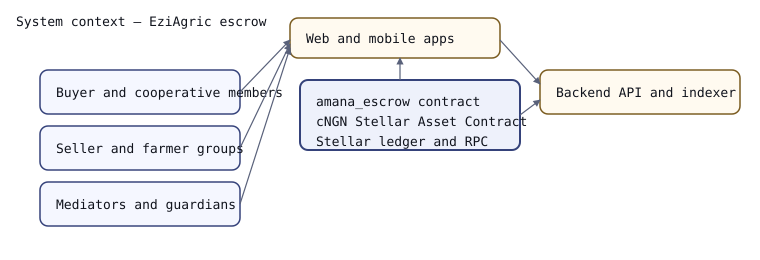
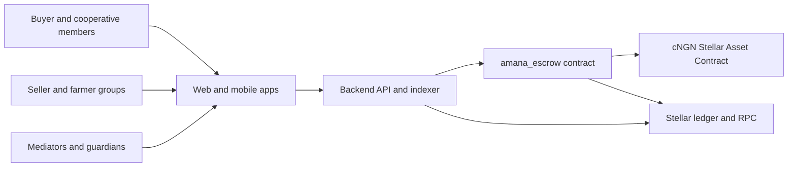

# System context

Who and what the escrow platform interacts with, and where value and truth
flow. One box is the system; everything else is external to it.

<!-- docref: contracts/amana_escrow/src/lib.rs#EscrowContract -->

## Reading it

- **Buyers and sellers** only ever talk to the apps. They sign transactions with
  their own keys, so the escrow contract, not the platform, is what enforces a
  settlement.
- **The apps** are stateless views. They read trade state through the backend and
  never hold funds.
- **The backend** is the only component that both writes to the contract (on
  behalf of a signed-in party) and reads the Stellar network. It is a
  convenience, not a trust boundary: a trade can be settled with the contract
  alone.
- **The escrow contract** moves cNGN only through the Stellar Asset Contract for
  cNGN, and only along the paths in
  [`sequences/trade-lifecycle.md`](sequences/trade-lifecycle.md).
- **Mediators and guardians** act through the same apps but hold separate keys;
  their authority (adding mediators, weights, quorum, pausing) is checked
  on-chain.

Diagrams in this directory are the source of truth for structure. If a change
alters which components talk to each other, or the order of messages in one of
the sequences, update the diagram in the same pull request — see
[README.md](README.md).
